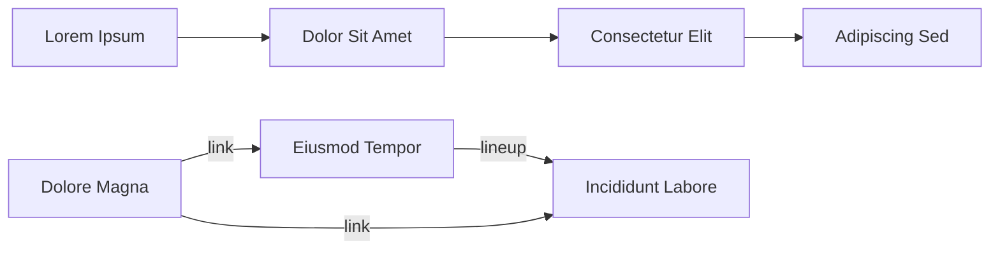

import {
	Badge,
	StepItem,
	Steps,
	TabGroup,
	Timeline,
	TimelineItem,
} from "@components/firefly-mdx";

Lorem ipsum dolor sit amet, consectetur adipiscing elit. Sed do eiusmod tempor incididunt ut labore et dolore magna aliqua. Ut enim ad minim veniam, quis nostrud exercitation ullamco laboris nisi ut aliquip ex ea commodo consequat.

## 1. Lorem Ipsum Dolor & Sit Amet

Duis aute irure dolor in reprehenderit in voluptate velit esse cillum dolore eu fugiat nulla pariatur:

| Lorem Key | Ipsum Value | Consectetur |
| :--- | :--- | :--- |
| `useRandomCover` | `true` | Lorem ipsum dolor sit amet consectetur adipiscing elit |
| `pinned` | `true` | Ut enim ad minim veniam quis nostrud exercitation |
| `series` / `seriesOrder` | `"Getting Started"` / `1` | Duis aute irure dolor in reprehenderit in voluptate |
| `draft` | `false` | Excepteur sint occaecat cupidatat non proident |
| `password` | `""` | Sunt in culpa qui officia deserunt mollit anim id est laborum |

Lorem ipsum dolor: <Badge>Default</Badge> <Badge type="tip">Tip</Badge> <Badge type="note">Note</Badge> <Badge type="important">Important</Badge> <Badge type="warning">Warning</Badge> <Badge type="caution">Caution</Badge>

---

## 2. Consectetur Adipiscing `[[Wiki Links]]`

Sed ut perspiciatis unde omnis iste natus error sit voluptatem accusantium doloremque laudantium:

- Lorem ipsum link: [[performers/hana-minase]]
- Dolor sit amet link: [[ren-takahashi]]
- Consectetur event link: [[events/axia-winter-live-2026|Lorem Ipsum Live 2026]]
- Eiusmod archive link: [[events/jakarta-anifest-summer-2026]]

Nemo enim ipsam voluptatem quia voluptas sit aspernatur aut odit aut fugit:

[[events/axia-winter-live-2026]]

[[events/bandung-mall-matsuri-2026]]

[[performers/hana-minase]]

---

## 3. Tempor Incididunt & Spoiler Text

> [!NOTE]
> Lorem ipsum dolor sit amet, consectetur adipiscing elit, sed do eiusmod tempor incididunt ut labore et dolore magna aliqua.

> [!TIP]
> Ut enim ad minim veniam, quis nostrud exercitation ullamco laboris nisi ut aliquip ex ea commodo consequat.

> [!IMPORTANT]
> Duis aute irure dolor in reprehenderit in voluptate velit esse cillum dolore eu fugiat nulla pariatur.

> [!WARNING]
> Excepteur sint occaecat cupidatat non proident, sunt in culpa qui officia deserunt mollit anim id est laborum.

> [!CAUTION]
> Sed ut perspiciatis unde omnis iste natus error sit voluptatem accusantium doloremque laudantium, totam rem aperiam.

Lorem spoiler: :spoiler[Sed do eiusmod tempor incididunt ut labore et dolore magna aliqua enim ad minim veniam.]

---

## 4. Magni Dolores Components

### Eiusmod (`TabGroup`)

<TabGroup labels={["Lorem Tab A", "Ipsum Tab B"]} client:load>
	```yaml
	# Lorem ipsum dolor sit amet
	title: "Consectetur Adipiscing Elit"
	startDate: 2026-12-05
	region: "Jawa Barat"
	eventType: "Matsuri / Bunkasai"
	entryType: "free"
	htm: "Free Entry"
	lineup:
	  - "hana-minase"
	```

	```yaml
	# Ut enim ad minim veniam
	title: "Sed Do Eiusmod Tempor"
	startDate: 2026-12-19
	region: "Jabodetabek"
	eventType: "Idol / Anisong Live"
	entryType: "paid"
	htm: "Rp 120.000 / Rp 150.000"
	```
</TabGroup>

### Ratione Voluptatem (`Steps`)

<Steps>
	<StepItem title="Lorem Ipsum Dolor" icon="edit">
		Lorem ipsum dolor sit amet, consectetur adipiscing elit, sed do eiusmod tempor incididunt.
	</StepItem>
	<StepItem title="Ut Enim Ad Minim" type="tip" icon="calendar">
		Ut enim ad minim veniam, quis nostrud exercitation ullamco laboris nisi ut aliquip.
	</StepItem>
	<StepItem title="Duis Aute Irure" type="note" icon="rocket">
		Duis aute irure dolor in reprehenderit in voluptate velit esse cillum dolore.
	</StepItem>
</Steps>

### Neque Porro Quisquam (`Timeline`)

<Timeline>
	<TimelineItem date="2026-08-15" title="Lorem Ipsum Archive" type="note" icon="tag">
		Sed ut perspiciatis unde omnis iste natus error sit voluptatem accusantium.
	</TimelineItem>
	<TimelineItem date="2026-11-26" title="Dolor Sit Amet" type="tip" icon="rocket">
		Nemo enim ipsam voluptatem quia voluptas sit aspernatur aut odit aut fugit.
	</TimelineItem>
	<TimelineItem date="2026-12-19" title="Consectetur Elit" icon="star">
		Quis autem vel eum iure reprehenderit featuring [[performers/hana-minase]] and [[performers/ren-takahashi]].
	</TimelineItem>
</Timeline>

---

## 5. Quia Dolor Sit Amet

```yaml title="lorem-ipsum-sample.md"
title: "Lorem Ipsum Dolor"
startDate: 2027-01-16
venue: "Lorem Hall"
city: "Surabaya"
region: "Jawa Timur"
eventType: "Anikura / DJ Night"
entryType: "paid"
htm: "Rp 65.000"
time: "18:00 - 23:30"
timezone: "WIB"
```

```bash title="Lorem Terminal"
pnpm dev
pnpm check && pnpm type-check && pnpm build
```

---

## 6. Consequuntur Magni (Mermaid)



---

## 7. Labore et Dolore (KaTeX)

Lorem ipsum math: $T = P + F$, ut enim ad minim veniam $P$ quis nostrud $F$ exercitation.

$$
\text{Lorem Ipsum} = \begin{cases}
\text{Dolor Sit}, & \text{if } A \ge B \\
\text{Amet Elit}, & \text{otherwise}
\end{cases}
$$

---

## 8. Quis Nostrum Exercitationem

- [x] Lorem ipsum dolor sit amet, consectetur adipiscing elit
- [x] Sed do eiusmod tempor incididunt ut labore et dolore magna aliqua
- [ ] Ut enim ad minim veniam, quis nostrud exercitation ullamco laboris

::github{repo="raitoklaus/axia-zone-id"}
