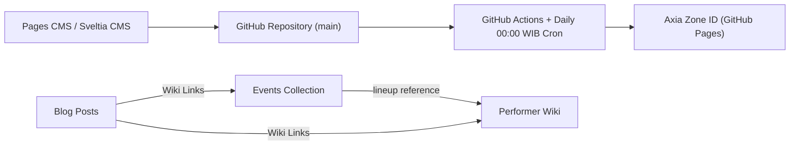

import {
	Badge,
	StepItem,
	Steps,
	TabGroup,
	Timeline,
	TimelineItem,
} from "@components/firefly-mdx";

This single post demonstrates the full feature set available across **Axia Zone ID**: Firefly's Markdown/MDX publishing features alongside the connected **Indonesian ACG Event Schedule** and **Performer Wiki**.

## 1. Frontmatter & Inline Badges

Every post supports rich metadata in YAML frontmatter (editable locally or via Pages CMS and Sveltia CMS):

| Frontmatter Key | Current Value | Purpose |
| :--- | :--- | :--- |
| `useRandomCover` | `true` | Falls back to Firefly's random cover API when `image` is blank |
| `pinned` | `true` | Pins the post to the top of the blog feed |
| `series` / `seriesOrder` | `"Getting Started"` / `1` | Adds an automatic series navigation box |
| `draft` | `false` | Hides unfinished posts from production builds when `true` |
| `password` | `""` | Optionally encrypts a post's body with client-side decryption |

Inline MDX badges: <Badge>Default</Badge> <Badge type="tip">Tip</Badge> <Badge type="note">Note</Badge> <Badge type="important">Important</Badge> <Badge type="warning">Warning</Badge> <Badge type="caution">Caution</Badge>

---

## 2. Connected Wiki & Obsidian `[[Wiki Links]]`

Use Obsidian-style `[[Wiki Links]]` anywhere in blog posts, performer profiles, or event pages:

- Prefixed performer link: [[performers/hana-minase]]
- Bare-slug performer link: [[ren-takahashi]]
- Aliased event link: [[events/axia-winter-live-2026|Axia Winter Live 2026]]
- Past event archive link: [[events/jakarta-anifest-summer-2026]]

Place a `[[Wiki Link]]` alone on its own paragraph to render a rich summary card:

[[events/axia-winter-live-2026]]

[[events/bandung-mall-matsuri-2026]]

[[performers/hana-minase]]

---

## 3. Admonitions (GitHub Callouts) & Spoiler Text

> [!NOTE]
> Use `> [!NOTE]` callouts for background context, schedule changes, or venue rules.

> [!TIP]
> Events tagged with `entryType: "free"` automatically highlight **Free Entry** badges on the homepage and calendar.

> [!IMPORTANT]
> Always link performers in `lineup: ["performer-slug"]` so their Upcoming and Past Appearances update automatically.

> [!WARNING]
> Check `WIB`, `WITA`, or `WIT` timezone labels when adding events outside Java.

> [!CAUTION]
> Never commit `.env` files, personal access tokens, or OAuth secrets to the repository.

Spoiler preview (hover to reveal): :spoiler[Secret encore acoustic collab between Hana Minase and Ren Takahashi at Balai Sarbini.]

---

## 4. Interactive MDX Components

### Tabs (`TabGroup`)

<TabGroup labels={["Pages CMS (.pages.yml)", "Sveltia CMS (/admin/)"]} client:load>
	```yaml
	# Edit on desktop or mobile via https://app.pagescms.org
	title: "Bandung Mall Matsuri 2026"
	startDate: 2026-12-05
	region: "Jawa Barat"
	eventType: "Matsuri / Bunkasai"
	entryType: "free"
	htm: "Free Entry"
	lineup:
	  - "hana-minase"
	```

	```yaml
	# Edit via https://axia.zone.id/admin/
	# Searchable relation dropdown automatically picks performer slugs
	title: "Axia Winter Live 2026"
	startDate: 2026-12-19
	region: "Jabodetabek"
	eventType: "Idol / Anisong Live"
	entryType: "paid"
	htm: "Presale Rp 120.000 / OTS Rp 150.000"
	```
</TabGroup>

### Publishing Workflow (`Steps`)

<Steps>
	<StepItem title="Create Performer Profiles" icon="edit">
		Add Markdown entries under `src/content/performers/` with role, bio, tags, and social links.
	</StepItem>
	<StepItem title="Publish Event Schedule" type="tip" icon="calendar">
		Create an event under `src/content/events/` (or via online CMS) with region, HTM, hours, and `lineup`.
	</StepItem>
	<StepItem title="Cross-Link in Blog Posts" type="note" icon="rocket">
		Reference performers and events inline or as cards with `[[Wiki Links]]`, then push or let the CMS deploy automatically.
	</StepItem>
</Steps>

### Event Season Timeline (`Timeline`)

<Timeline>
	<TimelineItem date="2026-08-15" title="Jakarta AniFest Summer 2026" type="note" icon="tag">
		Archived summer convention at ICE BSD Hall 3, Tangerang (`Jabodetabek`).
	</TimelineItem>
	<TimelineItem date="2026-11-26" title="Axia Zone ID Launch" type="tip" icon="rocket">
		Launched Astro 7 blog, Indonesian ACG event calendar, performer wiki, and dual Git-based CMS.
	</TimelineItem>
	<TimelineItem date="2026-12-19" title="Axia Winter Live 2026" icon="star">
		Upcoming two-day live showcase in Jakarta featuring [[performers/hana-minase]] and [[performers/ren-takahashi]].
	</TimelineItem>
</Timeline>

---

## 5. Expressive Code & Terminal Frames

```yaml title="src/content/events/sample-event.md"
title: "Surabaya Anikura Night 2027"
startDate: 2027-01-16
venue: "Tunjungan Club Hall"
city: "Surabaya"
region: "Jawa Timur"
eventType: "Anikura / DJ Night"
entryType: "paid"
htm: "Rp 65.000 (incl. FDC)"
time: "18:00 - 23:30"
timezone: "WIB"
```

```bash title="Local Verification"
pnpm dev
pnpm check && pnpm type-check && pnpm build
```

---

## 6. Architecture Diagram (Mermaid)



---

## 7. Math Formatting (KaTeX)

Inline math: total weekend pass cost $T = P + F$, where $P$ is presale ticket price and $F$ is admin fee.

$$
\text{Schedule Rollover} = \begin{cases}
\text{Upcoming}, & \text{if } \text{endDate} \ge \text{Today (WIB)} \text{ and } \text{status} \notin \{\text{completed}, \text{cancelled}\} \\
\text{Past Archive}, & \text{otherwise}
\end{cases}
$$

---

## 8. Next Steps & Repository

- [x] Remove default Firefly demo posts and demo config links
- [x] Verify Indonesian ACG Event Schedule, Calendar Grid, and Performer Wiki
- [ ] Add your own articles, performer profiles, and upcoming events via Git or the online CMS

::github{repo="raitoklaus/axia-zone-id"}
